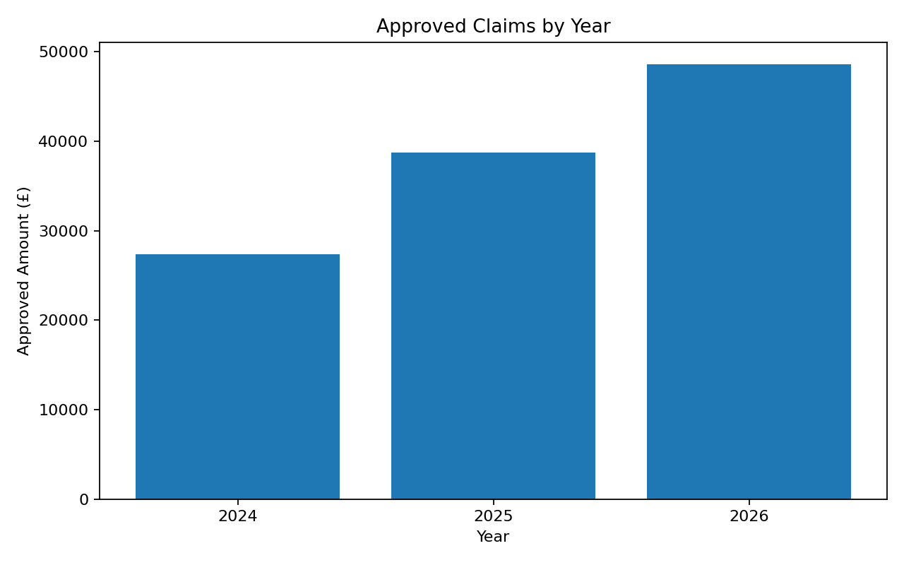

# Insurance Claims & Risk Analysis | SQL Portfolio 02

**SQL (SQLite) • Insurance analytics • KPI reporting • CTEs • Window functions**

A reproducible portfolio project using **synthetic insurance data from 2024–2026** to analyse claims volume, settlement performance, claim severity, policy-type exposure and outstanding claims.

> **Dataset notice:** All names, policies, premiums and claims are invented for learning and portfolio demonstration. They are not real employer, client or insurer records.

## Business questions

- How are claim volumes and approved amounts changing by year?
- What proportion of claims are settled, outstanding or rejected?
- How long do settled claims take to close?
- Which claim types and regions carry the highest claim value?
- Which policy types have the highest approved-claims-to-premium ratio?
- Which outstanding claims require management attention?
- Are the relational records complete and valid?

## Data model

| Table | Rows | Role |
|---|---:|---|
| `policyholders` | 8 | Customer and region information |
| `policies` | 12 | Policy type, annual premium and sum insured |
| `claims` | 24 | Claim dates, amounts, status and settlement date |

Relationships: `policyholders` 1→many `policies`; `policies` 1→many `claims`.

## Key results

| Year | Claims | Claimed | Approved | Avg claim | Settlement rate |
|---|---:|---:|---:|---:|---:|
| 2024 | 8 | £33,400 | £27,400 | £4,175 | 75.00% |
| 2025 | 8 | £51,000 | £38,750 | £6,375 | 75.00% |
| 2026 | 8 | £54,600 | £48,650 | £6,825 | 75.00% |



## Selected observations

- **Theft** generated the highest total claimed value at **£37,300** across the sample.
- **South** had the largest claimed amount at **£92,600**.
- Average settlement time moved from **16.2 days in 2024** to **18.2 days in 2026**.
- There are **4 outstanding claims** in the sample, with the largest approved outstanding amount equal to **£11,000**.
- Data-quality checks return zero orphan records, zero negative claim values and zero settled claims without settlement dates.

## SQL techniques demonstrated

`INNER JOIN`, `LEFT JOIN`, primary/foreign keys, `CASE`, `COUNT`, `SUM`, `AVG`, `ROUND`, `NULLIF`, `julianday`, `strftime`, CTEs, `LAG() OVER`, conditional filtering, ranking-style ordering and data-quality checks.

## Project files

```text
insurance-claims-risk-analysis/
├── README.md
├── 01_create_tables.sql
├── 02_insert_data.sql
├── 03_business_analysis.sql
├── 01_annual_claims_kpis.csv
├── 02_claim_status.csv
├── 03_settlement_time.csv
├── 04_claim_type_risk.csv
├── 05_regional_performance.csv
├── 06_policy_type_ratio.csv
├── 07_outstanding_claims.csv
├── 08_yoy_approved_growth.csv
├── 09_data_quality.csv
└── approved_claims_by_year.png
```

## How to reproduce

1. Open a fresh SQLite database.
2. Run [01_create_tables.sql](01_create_tables.sql).
3. Run [02_insert_data.sql](02_insert_data.sql).
4. Run the nine queries in [03_business_analysis.sql](03_business_analysis.sql) individually.
5. Compare the outputs with the CSV result files included in this repository.

## Interpretation and limitations

This is a small synthetic dataset intended to demonstrate SQL analysis techniques. The approved-claims-to-premium ratio in this project is a simple portfolio comparison using the premiums stored in the sample; it is **not** a formal actuarial loss ratio and should not be interpreted as one.

Potential follow-up analysis could include claim frequency per policy-year, fraud indicators, reserve development, customer retention and larger multi-year exposure data.
